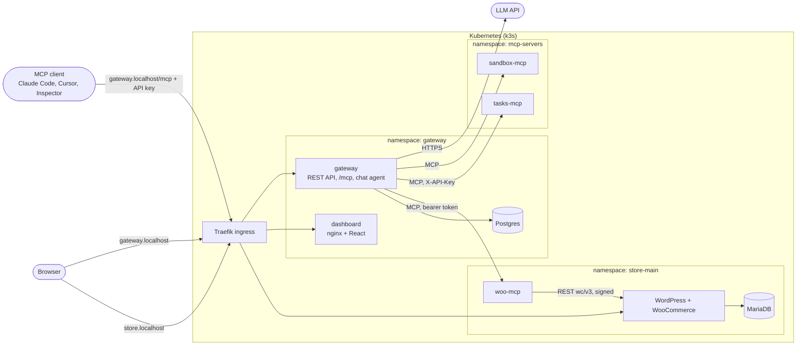

# Plan: WooCommerce hosting with a team MCP gateway

The spec is [ASSIGNMENT.md](ASSIGNMENT.md). This file records what gets built, in
what order, and why each choice was made. Section 4 covers the mechanisms the
brief asks to be documented and defended.

**Status:** M0 (cluster) and M1 (store chart) are built and verified. Everything
from M2 on is design, not yet built.

## 1. Architecture



Two public hosts, both through Ingress:

| Host | Serves |
|---|---|
| `store.localhost` | Storefront and wp-admin |
| `gateway.localhost` | `/` dashboard, `/api/*` REST API, `/mcp` the single MCP endpoint |

Nothing else has an Ingress. The gateway is the only caller of every MCP server,
for external clients and for the chat agent alike.

## 2. Stack

| Layer | Choice | Why | Not chosen |
|---|---|---|---|
| Local Kubernetes | k3d: k3s v1.36.5 in Docker (Colima VM on macOS) | The VPS target is k3s, so local runs the same distribution with the same bundled Traefik, ServiceLB, local-path storage and NetworkPolicy controller. Only values differ. | kind and minikube ship different ingress, storage and CNI defaults |
| Packaging | Helm, three charts, each with `values.yaml`, `values-local.yaml`, `values-prod.yaml` | Required by the brief. One chart per namespace-sized unit, so the store chart can be installed once per store later (bonus). | One umbrella chart: a release cannot cleanly span namespaces |
| Manifests | Hand-written templates on official images | Every resource has to be explainable in the interview. | Bitnami charts: opaque, and their images left the free catalog in 2025 |
| Ingress | k3s's bundled Traefik through plain `networking.k8s.io/v1` Ingress, class name from values | Portable: no Traefik CRDs, so another controller works by changing one value. | IngressRoute CRDs |
| Store | Official `wordpress` image extended with WP-CLI, a pinned WooCommerce and the Storefront theme. An idempotent setup script, run as an init container, installs and configures the store on every pod start. MariaDB LTS as a StatefulSet. PVCs for the database and `wp-content`. | Reproducible store with no setup wizard and no downloads at pod start. | Installing plugins at runtime from a Job |
| WooCommerce MCP server | Python, official MCP SDK 2.x, Streamable HTTP, WooCommerce REST API v3 | See 4.2. | WP-CLI, direct SQL |
| Gateway | Python, FastAPI, SQLAlchemy + Alembic, Postgres. The official MCP SDK on both sides: low-level server for `/mcp`, client for upstreams. | One language for all backend services. Postgres rather than SQLite because the audit log has concurrent writers and more than one gateway replica must share state. | A proxy framework that hides routing, auth and audit |
| Dashboard | React 19 + Vite + TypeScript, Tailwind + shadcn/ui, TanStack Query. Static build served by unprivileged nginx. | Same origin as the API, so cookie auth needs no CORS. | Serving the SPA from the API pod |
| Chat agent | Tool loop written by hand in the gateway on Google's Gen AI Python SDK, with a Gemini model on the free tier, streamed to the browser over SSE. Model name is a Helm value, API key is a Secret. | The brief grades the loop, so we own it. It asks the same per-user tool view that `/mcp` serves, so it cannot see or call anything an external client could not. The free tier keeps the demo at zero cost. | A framework's agent loop; a local model, which would take memory the cluster needs |
| Other upstreams | `tasks-mcp`: small stateful task list, needs an `X-API-Key` header. `sandbox-mcp`: `echo`, `slow`, `fail` and one tool name that collides with woo-mcp. | Together with woo-mcp (bearer) they exercise all three credential modes, a cross-server prompt, the collision scheme and the timeout path. | Wrapping third-party stdio servers |
| Images | Built locally, pushed to the k3d registry as `localhost:5001/<name>:<tag>`. Prod: multi-arch images on GHCR. | Same pull-by-tag flow in both environments; only `image.registry` changes. | `k3d image import` |
| Secrets | Kubernetes Secrets with random values, generated by the chart on first install and read back with `lookup` on every upgrade. `existingSecret` replaces them with ones you manage. | `helm install` works with no preparation, values files and git never contain a secret, and an upgrade cannot rotate a database password out from under its data. | Secrets in values files; a separate bootstrap script |

Every backend service is Python. The dashboard is TypeScript.

## 3. Chart conventions

Every workload gets: readiness and liveness probes, CPU and memory requests and
limits, a non-root `securityContext` with all capabilities dropped, and a
NetworkPolicy. Namespaces are default-deny for ingress, with explicit allows.

Local versus prod is values only: ingress hosts and TLS, image registry and tag,
storage size and class, resources, replica counts, cookie security.

## 4. Mechanisms to document and defend

### 4.1 Local domains

`*.localhost` names resolve to loopback with no configuration (RFC 6761). On this
machine that was checked for the system resolver, Node, Python, curl and browsers.
k3d publishes ports 80 and 443 on `127.0.0.1` only, so URLs are stable, need no
`/etc/hosts` edit and are not served to the LAN (checked: a connection to the LAN
address is dropped).

Inside a pod `*.localhost` is the pod itself, so in-cluster callers always use
Service DNS names and never the public hostnames.

Prod uses real DNS names from `values-prod.yaml` and TLS from cert-manager.

### 4.2 How woo-mcp talks to the store

WooCommerce REST API v3, over in-cluster HTTP to the WordPress Service.

* It is WooCommerce's supported, versioned contract. Validation, stock handling,
  order notes and emails run exactly as they do from wp-admin.
* The coupling is network-only. woo-mcp needs no access to the WordPress
  filesystem, the database or the Kubernetes API, so it is a small stateless
  container that a NetworkPolicy can fence in completely.
* Access is a revocable WooCommerce API key bound to a dedicated `shop_manager`
  user rather than an administrator.

Rejected: WP-CLI needs either `kubectl exec` rights (cluster credentials inside
the MCP server) or the WordPress volume and database password mounted into it,
and both destroy the isolation the brief asks for. Direct SQL bypasses
WooCommerce's logic.

Authentication: WooCommerce accepts the key pair as Basic auth only over HTTPS.
TLS ends at the ingress and in-cluster traffic is plain HTTP, so woo-mcp signs
each request with WooCommerce's one-legged OAuth 1.0a (HMAC-SHA256) and the
secret never crosses the wire. The key pair is generated into the store's
Kubernetes Secret, the store's setup container registers it in WooCommerce for a
dedicated `mcp-bot` shop manager, and woo-mcp mounts the same Secret. No
component needs permission to write Secrets.

Checked on WooCommerce 11.2 over plain HTTP: Basic auth and keys in the query
string both return 401, a correctly signed request returns 200, and a request
signed with the wrong secret returns 401.

### 4.3 Tool name collisions

Every tool is exposed as `<server-slug>__<tool>`, for example `woo__list_orders`.

* Always prefixed, not only on collision. Adding a server never renames an
  existing tool, so prompts, permissions and audit history stay stable.
* The slug is chosen when the server is registered, matches `^[a-z][a-z0-9-]*$`,
  is unique and cannot be changed afterwards. It cannot contain `_`, so splitting
  on the first `__` is unambiguous even if the upstream tool name contains `__`.
* The result uses only `[A-Za-z0-9_-]` and at most 64 characters, which every
  major model API accepts as a function name. An upstream tool that cannot fit
  is skipped and reported in the dashboard, never silently renamed.
* The description is prefixed with the server's display name so a model can tell
  two similar tools apart.

### 4.4 Slow or dead upstreams

* The gateway keeps a cached tool list and a status per upstream. A background
  probe (`initialize` + `tools/list`, short timeout) refreshes each upstream
  independently and concurrently.
* `tools/list` is answered from the cache, so it never waits on an upstream.
* `tools/call` has a per-server timeout (default 30 s). A timeout or connection
  failure becomes a tool result with `isError: true` and a message naming the
  server and the reason. The upstream is marked unreachable immediately, with
  that reason shown in the dashboard, and the probe keeps retrying.
* Upstream sessions are short-lived: connect, initialize, call, close. A
  restarted upstream pod therefore needs no session repair, and any gateway
  replica can serve any request. Trade-off: upstreams that keep per-session
  state are not supported.
* The gateway's own `/mcp` endpoint is stateless for the same reason. It cannot
  push `tools/list_changed`; a client sees a disabled server's tools disappear
  on its next `tools/list`, and calls to them are rejected at once regardless.

### 4.5 Where each credential lives

| Credential | Stored | Held by | Never reaches |
|---|---|---|---|
| User password | Postgres, argon2id hash | nobody | anyone |
| Gateway API key | Postgres, SHA-256 hash and a short prefix. Shown once on creation. | The user and their MCP client | Upstream servers |
| Dashboard session | Postgres, hashed. HttpOnly cookie in the browser. | The browser | Page JavaScript |
| Upstream credential (bearer or header) | Postgres, encrypted with a key from a Secret | Gateway process | Browser and MCP clients. The API only reports whether one is set. |
| WooCommerce API key pair | Secret in the store namespace. WooCommerce stores an HMAC of the key. | woo-mcp and WooCommerce | Gateway and users |
| WordPress admin password | Secret in the store namespace. WordPress stores a hash. | The store's admin; the setup container on first boot | The web container's environment, any log |
| Database passwords | Secrets | Each database and its one client | Everything else |
| LLM API key | Secret in the gateway namespace | Gateway process | Browser |

API keys are random 256-bit values, so a fast hash is the right tool: there is
nothing to brute-force, and it allows an indexed lookup on every request. That
per-request lookup is also what makes revocation take effect on the next call.

### 4.6 Where isolation is enforced

1. **Network.** MCP servers have a ClusterIP Service and nothing else: no
   Ingress, no NodePort. Their namespaces deny ingress by default and allow only
   the gateway pods. WordPress accepts Traefik and woo-mcp; MariaDB accepts only
   WordPress; Postgres accepts only the gateway.
2. **Application.** Each MCP server also requires a static credential that only
   the gateway holds, so a pod that slipped past the network rule still gets a 401.
3. **Identity.** Every gateway request carries an API key or a session, is
   checked against role and server state, and is written to the audit log with
   user, server, tool, timestamp, duration and outcome.

### 4.7 How a store pod is put together

| Lives in | What | Lifetime |
|---|---|---|
| Image | WordPress core, WP-CLI, WooCommerce and Storefront as pinned zips, `wp-config.php`, the setup script | Replaced by deploying a new image tag |
| `emptyDir` web root | Core files copied out of the image | Rebuilt on every pod start |
| Volume `wp-content` | Uploads, installed plugins and themes | Survives pods and `helm uninstall` |
| Volume on MariaDB | Products, orders, customers, settings | Survives pods and `helm uninstall` |
| Secret | Database passwords, admin password, cookie-signing keys, API key pair | Survives `helm uninstall` |

`wp-config.php` holds no per-store value. It reads the database location, the
cookie keys and the public URL from the environment, so one image serves every
store.

The pod has two containers from that image:

* **`setup`** (init container) runs on every start and is safe to repeat. Its
  *always* steps keep platform invariants: copy core into the web root, wait for
  the database, install WordPress if absent, bring WooCommerce and the theme up
  to the image's pinned version, run database migrations, register the API key.
  Its *first boot* steps apply defaults an admin may later change (admin
  password, theme, currency, cash on delivery, front page, sample products) and
  are guarded by a marker option so a restart never undoes work done in wp-admin.
* **`wordpress`** runs Apache and nothing else, as a non-root user on a read-only
  root filesystem. It is never given the admin password or the API secret.

A CronJob requests `wp-cron.php` every five minutes. WordPress's own
trigger-on-page-view cron is turned off, so scheduled work does not depend on
visitors.

The Deployment uses `Recreate`: the content volume is ReadWriteOnce, so an
upgrade is a short outage rather than a rolling one.

## 5. Data model (gateway)

* `users`: email, name, role (`admin` or `member`), password hash, status
* `invites`: token hash, email, role, expiry, accepted time
* `sessions`: token hash, user, expiry
* `api_keys`: user, name, prefix, key hash, created, last used, revoked time
* `upstream_servers`: slug, name, URL, auth type (`none`, `bearer`, `header`),
  header name, encrypted secret, enabled, timeout
* `audit_log`: timestamp, user, API key, source (`mcp` or `chat`), server, tool,
  duration, outcome (`ok`, `error`, `timeout`, `denied`), error text

## 6. Repository layout

```
charts/
  store/          WordPress + MariaDB + woo-mcp, one release per store namespace
  gateway/        gateway API + dashboard + Postgres
  mcp-server/     generic chart for an MCP server image (tasks, sandbox)
services/
  gateway/        FastAPI app: REST, /mcp, upstream manager, chat agent
  woo-mcp/        WooCommerce MCP server
  tasks-mcp/
  sandbox-mcp/
  dashboard/      React app
images/
  wordpress/      Dockerfile and bootstrap script for the store image
deploy/local/     k3d cluster config
scripts/          cluster-up, image build, smoke tests
docs/
```

## 7. Build order

Each milestone ends on something from the brief's definition of done.

| # | Milestone | Done when |
|---|---|---|
| M0 | Cluster and skeleton | `make cluster-smoke` passes. **Done.** |
| M1 | Store chart | By hand: storefront, add to cart, COD checkout, order visible in wp-admin. Data survives deleting both pods. **Done:** `make store-smoke` automates the checkout. |
| M2 | woo-mcp | The five required tools work from MCP Inspector over a temporary port-forward. A pod in another namespace cannot connect. |
| M3 | Gateway core, plus tasks-mcp and sandbox-mcp | Claude Code, given only the gateway URL and a key, lists the tools of all three servers, answers the orders question and runs a two-server prompt. A revoked key is rejected. Killing one upstream pod leaves the others working. |
| M4 | Dashboard | Every admin and member user story is clickable. No response body ever contains an upstream credential. |
| M5 | Chat agent | Creates a product that appears on the storefront, then reports today's orders. Tool calls are shown in the chat and audited as the logged-in user. |
| M6 | Submission pass | `values-prod.yaml` for each chart, README (run, deploy, design), a demo script that walks every definition-of-done line. |

Then, in this order, as time allows:

1. Security hardening (default-deny policies, non-root, encrypted credentials and
   an SSRF guard on server URLs). Most of it is already in the design above.
2. Tool permissions per role. Small once the router exists.
3. Observability: a metrics endpoint and the unreachable reasons from 4.4.
4. VPS deployment with TLS. It proves the "same charts" claim.
5. Multi-store bonus. The store chart is already one namespace per store.
6. Scaling, OAuth, many-tools search, hosted MCP servers.

## 8. Risks and things learned

Confirmed while building M1:

* **WooCommerce 11.2 refuses Basic auth over HTTP**, as 4.2 assumed.
* **A new WooCommerce store starts in "coming soon" mode.** The setup script
  turns it off.
* **Checkout does not need a shipping method.** With none configured,
  WooCommerce skips shipping. The earlier worry about this was unfounded.
* **A NetworkPolicy allows a new pod a moment late.** A rule that allows pods by
  label learns a new pod's IP shortly after it starts. A client that connects in
  its first milliseconds is refused: in a burst test, 28 of 30 fresh cron pods
  failed this way. Anything that connects at startup must retry. The cron job
  does now, the setup script already loops on the database, and the gateway's
  upstream probe (4.4) retries by design.
* **Default-deny also blocks Traefik** until the ingress controller is allowed
  explicitly. The store chart has that rule.

Still open:

* **MCP Python SDK is 2.x** (`MCPServer`, `Client`), released July 2026. Code is
  written from its documentation, not from 1.x examples.
* **Gemini free tier.** It is rate limited per minute and per day, so the chat
  agent must report a rate-limit error clearly instead of hanging. MCP tool
  schemas are JSON Schema and may need adapting to Gemini's function
  declarations. Both to be checked at M5.
* **Store email is not delivered.** There is no mail server in the cluster, so
  WooCommerce's order emails fail quietly. Orders are unaffected.
* **Volume sizes are fixed at first install.** k3s's local-path storage cannot
  resize a volume, and a StatefulSet's volume template cannot be edited.
* **Helm 4** is installed locally. Charts stay on `apiVersion: v2`.
* **Capacity.** The VM has 8 GB. The cluster with one store uses about 1 GB.
  The host has about 43 GB of free disk, which images and build cache eat into.

## 9. Decisions made

1. **Backend language: Python.**
2. **LLM for the chat agent: Gemini on the free tier.** The provider sits behind
   one small adapter, so changing it later touches only that file and two Helm
   values.

## 10. What to be able to explain

1. One `tools/call` end to end: client, Traefik, gateway (auth, lookup, routing),
   upstream with its credential attached, WooCommerce, and back. Where it is audited.
2. The credential table in 4.5: who holds what, and what a browser or MCP client
   can ever see.
3. The three isolation layers in 4.6, and how to demonstrate each one failing closed.
4. Why tools are named `slug__tool` and what breaks without it.
5. What happens on key revocation, server disable and pod kill, and why the other
   servers are unaffected.
6. Why local and prod differ only in values.
7. The Kubernetes objects behind one workload: Deployment or StatefulSet, PVC and
   StorageClass binding, probes, requests and limits, Secret, Service, Ingress,
   NetworkPolicy.
