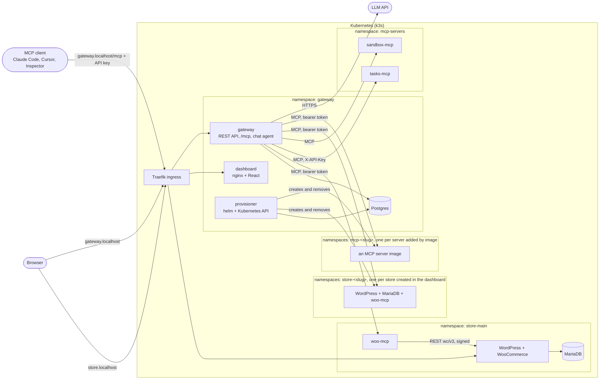

# Plan: WooCommerce hosting with a team MCP gateway

The spec is [ASSIGNMENT.md](ASSIGNMENT.md). This file records what gets built, in
what order, and why each choice was made. Section 4 covers the mechanisms the
brief asks to be documented and defended.

**Status:** every layer is built and verified end to end on the local cluster,
including the multi-store bonus and the chat agent against the real model
(`make chat-smoke`). The production deployment has been rehearsed end to end on
a separate virtual machine running k3s, with production values and HTTPS
([DEPLOY.md](DEPLOY.md)); it has not been run on a rented server with a public
address.

## 1. Architecture



Two public hosts, both through Ingress:

| Host | Serves |
|---|---|
| `store.localhost` | Storefront and wp-admin |
| `gateway.localhost` | `/` dashboard, `/api/*` REST API, `/mcp` the single MCP endpoint |
| `<slug>.localhost` | The storefront of a store created from the dashboard |

Nothing else has an Ingress. The gateway is the only caller of every MCP server,
for external clients and for the chat agent alike.

## 2. Stack

| Layer | Choice | Why | Not chosen |
|---|---|---|---|
| Local Kubernetes | k3d: k3s v1.36.5 in Docker (Colima VM on macOS) | The VPS target is k3s, so local runs the same distribution with the same bundled Traefik, ServiceLB, local-path storage and NetworkPolicy controller. Only values differ. | kind and minikube ship different ingress, storage and CNI defaults |
| Packaging | Helm, three charts, each with `values.yaml`, `values-local.yaml`, `values-prod.yaml` | Required by the brief. One chart per namespace-sized unit, so the store chart can be installed once per store later (bonus). | One umbrella chart: a release cannot cleanly span namespaces |
| Manifests | Hand-written templates on official images | Every resource has to be explainable in the interview. | Bitnami charts: opaque, and their images left the free catalog in 2025 |
| Ingress | k3s's bundled Traefik through plain `networking.k8s.io/v1` Ingress, class name from values | Portable: no Traefik CRDs, so another controller works by changing one value. | IngressRoute CRDs |
| Store | Official `wordpress` image extended with WP-CLI, a pinned WooCommerce and the Storefront theme. An idempotent setup script, run as an init container, installs and configures the store on every pod start. MariaDB LTS as a StatefulSet. PVCs for the database and `wp-content`. | Reproducible store with no setup wizard and no downloads at pod start. | Installing plugins at runtime from a Job |
| WooCommerce MCP server | Python, official MCP SDK 2.x, Streamable HTTP, WooCommerce REST API v3 | See 4.2. | WP-CLI, direct SQL |
| Gateway | Python, FastAPI, Postgres through asyncpg with plain SQL migrations. The official MCP SDK on both sides: low-level server for `/mcp`, client for upstreams. | One language for all backend services. Postgres rather than SQLite because the audit log has concurrent writers and more than one gateway replica must share state. Hand-written SQL, so every query can be read and explained. | A proxy framework that hides routing, auth and audit; an ORM |
| Dashboard | React 19 + Vite + TypeScript, Tailwind, TanStack Query, a few hand-written components. Static build served by unprivileged nginx. | Same origin as the API, so cookie auth needs no CORS. | Serving the SPA from the API pod; a component library |
| Chat agent | Tool loop written by hand in the gateway, calling the model through the OpenAI-compatible chat completions API over plain HTTP. Default: Gemini on its free tier. Base URL and model are Helm values, the API key is a Secret. | The brief grades the loop, so we own it. It asks the same per-user tool view that `/mcp` serves, so it cannot see or call anything an external client could not. That API shape is offered by Gemini, Groq, OpenRouter and Ollama alike, so the provider is settings, not code. | A vendor SDK or agent framework; a local model, which would take memory the cluster needs |
| Other upstreams | One image, two servers. `tasks`: a small task list, needs an `X-API-Key` header. `sandbox`: `echo`, `slow`, `fail`. Both have a tool called `server_info`. | Together with woo-mcp (bearer) they exercise all three credential modes, a cross-server prompt, the collision scheme and the timeout path. | Wrapping third-party stdio servers |
| Images | Built locally, pushed to the k3d registry as `localhost:5001/<name>:<tag>`. Prod: multi-arch images on GHCR. | Same pull-by-tag flow in both environments; only `image.registry` changes. | `k3d image import` |
| Secrets | Kubernetes Secrets with random values, generated by the chart on first install and read back with `lookup` on every upgrade. `existingSecret` replaces them with ones you manage. | `helm install` works with no preparation, values files and git never contain a secret, and an upgrade cannot rotate a database password out from under its data. | Secrets in values files; a separate bootstrap script |

Every backend service is Python. The dashboard is TypeScript.

## 3. Chart conventions

Every workload gets: readiness and liveness probes, CPU and memory requests and
limits, a non-root `securityContext` with all capabilities dropped, and a
NetworkPolicy. Namespaces are default-deny for ingress, with explicit allows.

Local versus prod is values only: ingress hosts and TLS, image registry and tag,
storage size and class, resources, replica counts, cookie security.

## 4. Mechanisms to document and defend

### 4.1 Local domains

`*.localhost` names resolve to loopback with no configuration (RFC 6761). On this
machine that was checked for the system resolver, Node, Python, curl and browsers.
k3d publishes ports 80 and 443 on `127.0.0.1` only, so URLs are stable, need no
`/etc/hosts` edit and are not served to the LAN (checked: a connection to the LAN
address is dropped).

Inside a pod `*.localhost` is the pod itself, so in-cluster callers always use
Service DNS names and never the public hostnames.

Prod uses real DNS names from `values-prod.yaml` and TLS from cert-manager.

### 4.2 How woo-mcp talks to the store

WooCommerce REST API v3, over in-cluster HTTP to the WordPress Service.

* It is WooCommerce's supported, versioned contract. Validation, stock handling,
  order notes and emails run exactly as they do from wp-admin.
* The coupling is network-only. woo-mcp needs no access to the WordPress
  filesystem, the database or the Kubernetes API, so it is a small stateless
  container that a NetworkPolicy can fence in completely.
* Access is a revocable WooCommerce API key bound to a dedicated `shop_manager`
  user rather than an administrator.

Rejected: WP-CLI needs either `kubectl exec` rights (cluster credentials inside
the MCP server) or the WordPress volume and database password mounted into it,
and both destroy the isolation the brief asks for. Direct SQL bypasses
WooCommerce's logic.

Authentication: WooCommerce accepts the key pair as Basic auth only over HTTPS.
TLS ends at the ingress and in-cluster traffic is plain HTTP, so woo-mcp signs
each request with WooCommerce's one-legged OAuth 1.0a (HMAC-SHA256) and the
secret never crosses the wire. The key pair is generated into the store's
Kubernetes Secret, the store's setup container registers it in WooCommerce for a
dedicated `mcp-bot` shop manager, and woo-mcp mounts the same Secret. No
component needs permission to write Secrets.

Checked on WooCommerce 11.2 over plain HTTP: Basic auth and keys in the query
string both return 401, a correctly signed request returns 200, and a request
signed with the wrong secret returns 401.

The server is documented in
[services/woo-mcp/README.md](../services/woo-mcp/README.md): its tools, the
signing, what protects it, and what MCP looks like on the wire.

### 4.3 Tool name collisions

Every tool is exposed as `<server-slug>__<tool>`, for example `woo__list_orders`.

* Always prefixed, not only on collision. Adding a server never renames an
  existing tool, so prompts, permissions and audit history stay stable.
* The slug is chosen when the server is registered, matches `^[a-z][a-z0-9-]*$`,
  is unique and cannot be changed afterwards. It cannot contain `_`, so splitting
  on the first `__` is unambiguous even if the upstream tool name contains `__`.
* The result uses only `[A-Za-z0-9_-]` and at most 64 characters, which every
  major model API accepts as a function name. An upstream tool that cannot fit
  is skipped and reported in the dashboard, never silently renamed.
* The description is prefixed with the server's display name so a model can tell
  two similar tools apart.

### 4.4 Slow or dead upstreams

* A background task checks every enabled upstream every ten seconds, all at
  once, each with its own five-second limit. It records whether the server
  answered, why not if it did not, and its tools.
* `tools/list` only reads what those checks found, so it never waits on an
  upstream. Only servers that answered their last check have their tools listed.
* `tools/call` has a per-server timeout (default 30 s). Failures are told apart:
  a server that cannot be reached is marked unreachable at once, with the reason
  shown in the dashboard; a server that took the request and then ran out of
  time fails only that call and stays connected; a tool that reports an error
  has it passed back. Each becomes a result with `isError: true` and a sentence
  naming the server and the reason.
* The gateway keeps no upstream session. MCP's current revision, 2026-07-28, has
  no handshake and no session at all: every call is one self-contained HTTP
  request. A restarted upstream pod therefore needs no repair, and any gateway
  replica can serve any request. An upstream that only speaks the older
  protocol gets a fresh handshake for each call. Trade-off: an upstream that
  keeps state between calls of one session is not supported.
* The gateway's own `/mcp` endpoint serves both generations of the protocol and
  keeps no session for either. A client sees a disabled server's tools
  disappear on its next `tools/list`, and calls to them are rejected at once
  regardless. Pushing a "tools changed" notification is a possible later
  addition.
* With several gateway replicas, each runs its own checks, so two can disagree
  about a server that has just died for up to one check interval. Revoking a
  key and disabling a server are read from the database on every request and
  apply everywhere at once.

The gateway's side of all this is documented in
[services/gateway/README.md](../services/gateway/README.md).

### 4.5 Where each credential lives

| Credential | Stored | Held by | Never reaches |
|---|---|---|---|
| User password | Postgres, argon2id hash | nobody | anyone |
| Gateway API key | Postgres, SHA-256 hash and a short prefix. Shown once on creation. | The user and their MCP client | Upstream servers |
| OAuth access and refresh tokens | Postgres, SHA-256 hashes | The MCP client that signed in | Upstream servers, the dashboard |
| Dashboard session | Postgres, hashed. HttpOnly cookie in the browser. | The browser | Page JavaScript |
| Upstream credential (bearer or header) | Postgres, encrypted with a key from a Secret | Gateway process | Browser and MCP clients. The API only reports whether one is set. |
| WooCommerce API key pair | Secret in the store namespace. WooCommerce stores an HMAC of the key. | woo-mcp and WooCommerce | Gateway and users |
| WordPress admin password | Secret in the store namespace. WordPress stores a hash. | The store's admin; the setup container on first boot | The web container's environment, any log |
| Database passwords | Secrets | Each database and its one client | Everything else |
| LLM API key | Secret in the gateway namespace | Gateway process | Browser |
| Kubernetes API token | Issued by Kubernetes to the provisioner's ServiceAccount, mounted in its pod, replaced hourly | Provisioner process only | The gateway API pods, which have no token at all |
| A hosted server's credential | Made up by the gateway when an admin adds a server by image. In Postgres encrypted, like any upstream credential; and in a Secret in the server's own namespace, put there by the provisioner | The gateway, and that server's container (as `AUTH_TOKEN`) | Browser, MCP clients, the admin who added the server |
| A created store's MCP token | Generated by the store chart into that store's Secret. The provisioner reads it once and stores it in Postgres, encrypted like any other upstream credential | That store's woo-mcp, and the gateway | Browser, MCP clients, other stores |

API keys are random 256-bit values, so a fast hash is the right tool: there is
nothing to brute-force, and it allows an indexed lookup on every request. That
per-request lookup is also what makes revocation take effect on the next call.

### 4.6 Where isolation is enforced

1. **Network.** MCP servers have a ClusterIP Service and nothing else: no
   Ingress, no NodePort. Their namespaces deny ingress by default and allow only
   the gateway pods. WordPress accepts Traefik and woo-mcp; MariaDB accepts only
   WordPress; Postgres accepts only the gateway. Outbound is restricted too:
   woo-mcp may reach only its own WordPress and cluster DNS, and MariaDB
   nothing. `make isolation-smoke` tries each connection and checks the result.
2. **Application.** Each MCP server also requires a static credential that only
   the gateway holds, so a pod that slipped past the network rule still gets a 401.
3. **Identity.** Every gateway request carries an API key or a session, is
   checked against role and server state, and is written to the audit log with
   user, server, tool, timestamp, duration and outcome.

The gateway's own outbound traffic is restricted as well, because it connects
wherever an admin's URL points: see 4.8. Stores created from the dashboard get
the same policies as the first one, each in its own namespace, so one store's
MCP server cannot reach another store's WordPress or database:
`make stores-smoke` tries it.

### 4.7 How a store pod is put together

| Lives in | What | Lifetime |
|---|---|---|
| Image | WordPress core, WP-CLI, WooCommerce and Storefront as pinned zips, `wp-config.php`, the setup script | Replaced by deploying a new image tag |
| `emptyDir` web root | Core files copied out of the image | Rebuilt on every pod start |
| Volume `wp-content` | Uploads, installed plugins and themes | Survives pods and `helm uninstall` |
| Volume on MariaDB | Products, orders, customers, settings | Survives pods and `helm uninstall` |
| Secret | Database passwords, admin password, cookie-signing keys, API key pair | Survives `helm uninstall` |

`wp-config.php` holds no per-store value. It reads the database location, the
cookie keys and the public URL from the environment, so one image serves every
store.

The pod has two containers from that image:

* **`setup`** (init container) runs on every start and is safe to repeat. Its
  *always* steps keep platform invariants: copy core into the web root, wait for
  the database, install WordPress if absent, bring WooCommerce and the theme up
  to the image's pinned version, run database migrations, register the API key.
  Its *first boot* steps apply defaults an admin may later change (admin
  password, theme, currency, cash on delivery, front page, sample products) and
  are guarded by a marker option so a restart never undoes work done in wp-admin.
* **`wordpress`** runs Apache and nothing else, as a non-root user on a read-only
  root filesystem. It is never given the admin password or the API secret.

A CronJob requests `wp-cron.php` every five minutes. WordPress's own
trigger-on-page-view cron is turned off, so scheduled work does not depend on
visitors.

The Deployment uses `Recreate`: the content volume is ReadWriteOnce, so an
upgrade is a short outage rather than a rolling one.

### 4.8 Server-side request forgery

An admin registers a server by typing a URL, and the gateway then sends requests
there from inside the cluster. Unchecked, that makes the gateway a way to reach
what only the cluster can reach: a cloud metadata address, the Kubernetes API,
the gateway's own database, a store's WordPress. Two layers refuse it.

**In the gateway** ([urlguard.py](../services/gateway/src/gateway/urlguard.py)),
applied to the address a host name resolves to:

* loopback, link-local (`169.254.169.254` is where metadata services live) and
  other special ranges: never;
* a private address: only if the host name matches the operator's list of
  in-cluster MCP servers, set in the chart
  (`*.mcp-servers.svc.cluster.local`, `*-woo-mcp.store-*.svc.cluster.local`);
* a public address: yes, unless the deployment switches public servers off.

The check runs when a server is added or edited, so the admin is told why, and
again on every connection, because what a name resolves to can change afterwards
(DNS rebinding). The connection is then made to the exact address that passed:
the HTTP client is given the IP, while the `Host` header and the TLS server name
still carry the host name, so certificates verify as usual. Redirects are not
followed. A URL with a user name or password in it is refused.

**In the network.** A NetworkPolicy on the API pods' outbound traffic allows DNS,
Postgres, any pod labelled `mcp-gateway/upstream=true` (both charts put that
label on their MCP server pods and on nothing else), and the public internet,
which is everything outside the private ranges. So even with the application
check bypassed, the API cannot open a connection to the Kubernetes API, a
database or a metadata address. `make isolation-smoke` tries each from the real
API pod; `make gateway-smoke` shows the dashboard's refusals.

### 4.9 Rate limits and metrics

**Rate limit.** One API key may make `api.rateLimitPerMinute` tool calls a
minute (120 by default; in the chat the limit is per person). The count is a row
in Postgres, incremented and read back in one statement, so the limit holds
across replicas and under concurrent calls. A call over the limit is not sent
upstream: it returns a tool error that says when to try again, and is audited
with the outcome `limited`.

**Metrics.** Each API pod serves Prometheus metrics at `/metrics`: tool calls by
server, outcome and source; a latency histogram per server; and, per upstream,
whether the last check succeeded and how many tools it has. The server label is
only ever a registered server, so made-up tool names cannot create unbounded
label values. The Ingress does not route `/metrics`, and a NetworkPolicy rule
for a Prometheus namespace is off until configured. The dashboard's own figures
(calls, failures, typical and slow latency per server over 24 hours, on the
audit page) are computed from the audit log instead, which every replica shares.

### 4.10 Stores created from the dashboard

The bonus. Any signed-in user can create a store; each gets its own namespace
`store-<slug>`, database, volumes, Secrets, quota and hostname, and its MCP
server appears in the gateway as `store-<slug>`, so its tools are
`store-<slug>__list_orders` and so on.

**Two components, one table.** The API never touches Kubernetes. Creating a
store inserts a row in `stores` with the status `provisioning`; deleting one
sets it to `deleting`. The **provisioner**
([provisioner.py](../services/gateway/src/gateway/provisioner/provisioner.py)) is
a separate Deployment that reads those rows every two seconds and makes the
cluster match, one task per store, three at a time. It is the same code base as
the gateway in an image of its own that adds the `helm` command and the store
chart, so the internet-facing API image carries neither, and the API pods hold
no Kubernetes credentials at all.

**The same chart.** A created store is `helm upgrade --install` of
`charts/store`, the chart `make store-up` uses for the first store, with the
environment's own values file plus the host, title and image tags.

**Steps, each of which checks first.** Create the namespace (labelled as the
provisioner's, and held to the `restricted` pod security standard); bind the
installer role there; install the release unless it is already deployed; wait
until every Deployment and StatefulSet is ready; read the store's MCP token and
register the server in the gateway; mark the row `ready`. Because every step
looks at what exists and does only what is missing, three situations become the
same one: a second click on "create" (also refused earlier, by a unique index),
"try again" on a failed store, and the provisioner being restarted halfway. In
each the steps run again from the top and skip what is done. A release that
helm left half-installed is cleared first. `make stores-smoke` deletes the
provisioner's pod while two stores are mid-install; both still come up.

**Failing cleanly.** The timeout (ten minutes) counts from a timestamp in the
row, so it survives a restart. A store that is not up in time is marked `failed`
with what it was last waiting for, taken from the pods ("store-wordpress
(ImagePullBackOff)", "exceeded quota"). A refusal from Kubernetes or an error
from helm fails at once with that message; a passing error (the API briefly
unavailable) is retried.

**Deleting.** The API marks the row and deletes the store's server registration
in one transaction, so its tools leave the gateway immediately. The provisioner
then deletes the namespace, which takes the pods, volumes, Secrets, Ingress and
its own permission there with it, waits until it is gone, and removes the row.

**Guardrails.** A ResourceQuota and LimitRange in every created namespace
(`charts/store/templates/quota.yaml`); at most three stores per person, counted
under a lock so simultaneous requests cannot both pass; the timeout above; and
only one provisioner works at a time, whichever holds a Postgres advisory lock.

**Least privilege.** RBAC grants the provisioner, across the cluster, only:
get, create and delete namespaces; create RoleBindings; and `bind` the one
ClusterRole `gateway-store-installer`. That role holds what installing a store
needs (exactly the kinds in the store chart) and is never bound cluster-wide:
the provisioner binds it to itself inside each namespace it creates. RBAC alone
cannot say "only in namespaces you created", so a ValidatingAdmissionPolicy
does: it refuses the provisioner's namespace creates, namespace deletes and
RoleBinding creates unless the namespace carries the label
`mcp-gateway/store` (or `mcp-gateway/hosted`, for the servers in 4.13), which
the provisioner can set only at creation because it has no permission to update
a namespace. The result, checked by
`make stores-smoke` using the provisioner's identity: it cannot read a Secret in
`gateway` or `kube-system`, cannot delete `store-main`, cannot create a
namespace that is not a store's, and cannot grant itself anything in
`kube-system` or anything beyond the installer role anywhere.

### 4.11 Many tools

Every store adds six tools, so ten stores is sixty before any other server.
Handing a model every definition on every request costs tokens and, past a few
dozen, makes it choose worse. The gateway therefore offers the same tools behind
two ([toolsearch.py](../services/gateway/src/gateway/toolsearch.py)):
`find_tools(query)` returns the few tools that match, with their input schemas,
and `call_tool(name, arguments)` runs one.

* An MCP client gets this at `/mcp/search` instead of `/mcp`, with the same key.
* The chat switches to it by itself once the user has more than
  `llm.toolSearchAbove` tools (40), and shows the real tool's name in the
  conversation, not the wrapper's.

Both go through the same `Gateway` object as the full list, so a user finds only
tools they are allowed to see, and a call made this way is checked,
rate-limited and audited under the real tool's name. Matching is by words: the
query and each tool's name and description are split into words, a word found in
the name counts three times one found in the description. That is deliberately
simple. It needs no second model, its results can be explained, and it works
because the naming scheme already puts the server and the action in every name.

### 4.12 Signing in with a browser (OAuth)

An API key has to be created in the dashboard and pasted into the client. The
MCP authorization specification describes the alternative, and the gateway
implements it ([oauth.py](../services/gateway/src/gateway/oauth.py)): the client
is given only the URL, opens a browser, and the person clicks Allow.

1. The client calls `/mcp` with no credential. The 401 carries
   `WWW-Authenticate: Bearer resource_metadata="…"`, pointing at a document that
   names the authorization server, which is the gateway itself.
2. The client reads the server's metadata and registers itself
   (`POST /register`): a name and the local address the browser should return to.
3. It opens the browser at `/authorize` with a *code challenge*: the hash of a
   random secret it keeps to itself (PKCE).
4. `/authorize` grants nothing. It puts the request aside and sends the browser
   to the dashboard's consent page, which needs a dashboard session. That is
   where a sign-in becomes tied to a user: whoever is signed in and clicks Allow.
5. The browser is sent back to the client with a one-time code.
6. The client exchanges the code, together with the secret behind the
   challenge, for an access token (one hour) and a refresh token (30 days).
   A code alone is useless to anyone who intercepts it.

From then on the access token is used exactly like an API key, and the gateway
treats it like one: looked up by hash on every request, mapped to the user, the
same permissions, rate limit and audit log (the entry reads "signed in: <client
name>"). Signing a client out in the dashboard deletes the row, and its next
request gets 401. Refreshing replaces both tokens, so a refresh token works once.

The endpoints and the protocol checks (redirect address, code challenge, client
authentication) are the MCP SDK's. What is the gateway's own is storage, all of
it hashed, and step 4. OAuth requires HTTPS; plain HTTP is accepted only for an
address on the same machine, such as `gateway.localhost`. Tested with the SDK's
own OAuth client in the unit tests, and step by step in `make gateway-smoke`. It
has not yet been tried with Claude Code or Cursor themselves.

### 4.13 Servers the platform hosts itself

An admin can add a server by container image instead of by URL
([hosted.py](../services/gateway/src/gateway/hosted.py)). The platform then
runs it, with nothing else to set up:

* **Where.** The provisioner installs `charts/mcp-server`, the chart that
  already runs the two demo servers, into a namespace of its own, `mcp-<slug>`.
  It reuses every step of store provisioning (4.10): the row is the request,
  each step checks first, a restart resumes, a timeout reports what it was
  waiting for ("ErrImagePull", "image will run as root").
* **What the container gets.** Resource limits; a non-root user and a read-only
  filesystem; no Kubernetes credentials; a namespace held to the `restricted`
  pod security standard, so the image cannot ask for more; a NetworkPolicy that
  admits only the gateway's API pods and, unless the admin ticks "may connect
  to the internet", lets the container open no connection at all.
* **The credential runs the other way round.** For a server added by URL the
  admin types in a credential the server already has. Here the gateway makes one
  up, stores it encrypted as usual, and the provisioner hands it to the server:
  into a Secret in the server's namespace, which the container receives as
  `AUTH_TOKEN`. It is passed to helm on standard input, not on the command
  line. An image that checks it (the demo image does) is protected twice; one
  that ignores it is still behind the NetworkPolicy. Nobody ever sees it.
* **In the gateway it is an ordinary server.** A hosted server is a normal
  `upstream_servers` row, with its in-cluster URL filled in from the start, plus
  what to run and how the deployment is going. So tool naming, permissions,
  health checks, rate limits and the audit log need nothing new. Until the pod
  is up the dashboard shows "Deploying" with the reason, not "Unreachable".
* **Changing and removing.** Editing the image, arguments or environment
  installs again, which Kubernetes turns into a rolling update. Removing the
  server disables it in the same statement, so its tools go at once; the
  provisioner then deletes the namespace and finally the row.
* **Guardrails.** `provisioner.hostedServers.allowedImagePrefixes` restricts
  which registries images may come from. The provisioner's admission policy
  (4.10) covers `mcp-` namespaces under a second label, `mcp-gateway/hosted`.

Not included: environment values that are secrets. The environment an admin
types is stored and shown as plain settings; a server that needs its own API
key for some outside service would need a second, encrypted kind.

`make hosted-smoke` adds a server by image, uses it as a member, checks what it
got in the cluster and that nothing else can reach it, changes what it runs,
tries an image that does not exist, and removes it.

## 5. Data model (gateway)

The schema is five short files in
[services/gateway/migrations](../services/gateway/migrations): the initial
tables, the rate-limit counter, stores, browser sign-in, and hosted servers.

* `users`: email, name, role (`admin` or `member`), password hash, active
* `invites`: token hash, email, role, expiry, accepted time
* `sessions`: token hash, user, expiry
* `api_keys`: user, name, prefix, key hash, created, last used, revoked time
* `upstream_servers`: slug, name, URL, auth type (`none`, `bearer`, `header`),
  header name, encrypted secret, enabled, timeout, and what members may use
  (`all`, `read_only`, `none`)
  For a server the platform runs from an image, also: what to run (image,
  arguments, environment, port, paths, internet), the deployment's status
  (`deploying`, `running`, `failed`, `deleting`) and detail.
* `seeded_servers`: slugs registered from the deployment's seed list, so a
  seeded server an admin removes stays removed
* `audit_log`: timestamp, user, API key, source (`mcp` or `chat`), server, tool,
  duration, outcome (`ok`, `error`, `timeout`, `unreachable`, `denied`,
  `limited`), error text. No foreign keys: the log outlives the user, key and
  server it describes.
* `rate_counters`: per API key (or per user for the chat), the calls made in the
  current minute
* `stores`: slug, name, owner, status (`provisioning`, `ready`, `failed`,
  `deleting`), what is happening or why it failed, URL, when the current attempt
  started. `upstream_servers.store_id` ties a store's server to it and removes
  the server when the store row goes.
* `oauth_clients`, `oauth_requests`, `oauth_codes`, `oauth_grants`: registered
  MCP clients, sign-ins awaiting an answer, one-time codes, and who is signed in
  where. Codes and tokens are stored as hashes.

## 6. Repository layout

```
charts/
  store/          WordPress + MariaDB + woo-mcp, one release per store namespace
  gateway/        gateway API + dashboard + Postgres + the store provisioner
  mcp-server/     generic chart for an MCP server image (tasks, sandbox)
services/
  gateway/        FastAPI app: REST, /mcp, upstream manager, chat agent;
                  and the provisioner (python -m gateway.provisioner)
  dashboard/      React app
  woo-mcp/        WooCommerce MCP server
  demo-mcp/       the tasks and sandbox servers, one image
images/
  wordpress/      Dockerfile and setup script for the store image
deploy/local/     k3d cluster config
scripts/          cluster-up, image build, end-to-end checks
docs/
```

## 7. Build order

Each milestone ends on something from the brief's definition of done.

| # | Milestone | Done when |
|---|---|---|
| M0 | Cluster and skeleton | `make cluster-smoke` passes. **Done.** |
| M1 | Store chart | By hand: storefront, add to cart, COD checkout, order visible in wp-admin. Data survives deleting both pods. **Done:** `make store-smoke` automates the checkout. |
| M2 | woo-mcp | The five required tools work from MCP Inspector over a temporary port-forward. A pod in another namespace cannot connect. **Done:** `make mcp-test`, `make mcp-smoke`, `make isolation-smoke`. |
| M3 | Gateway core, plus the tasks and sandbox servers | A client given only the gateway URL and a key lists the tools of all three servers, answers the orders question and runs a two-server task. A revoked key is rejected. Killing one upstream pod leaves the others working. **Done:** `make gateway-smoke` walks all of it; also run with two API replicas. |
| M4 | Dashboard | Every admin and member user story is clickable. No response body ever contains an upstream credential. **Done:** clicked through in a browser; the credential rule is a unit test. |
| M5 | Chat agent | Creates a product that appears on the storefront, then reports today's orders. Tool calls are shown in the chat and audited as the logged-in user. **Done:** `make chat-smoke` runs exactly this against Gemini; `STORES=1` adds the two-store comparison. |
| M6 | Submission pass | `values-prod.yaml` for each chart, README (run, deploy, design), a demo script that walks every definition-of-done line. **Done:** [DEMO.md](DEMO.md), [DEPLOY.md](DEPLOY.md). |

Beyond the core, from the brief's list of extras:

| Extra | State |
|---|---|
| Multi-store bonus | Done, see 4.10. `make stores-smoke` creates two stores at once, kills the provisioner midway, compares the stores' orders through the gateway, checks isolation and the provisioner's permissions, and deletes a store. `make chat-smoke STORES=1` runs the bonus's own test: the chat agent compares today's orders across two stores, one is deleted, and its tools and namespace are gone. |
| Security hardening | Done: SSRF guard in the application and in the network (4.8), least-privilege RBAC plus an admission policy for the one component that talks to the Kubernetes API (4.10), deny-by-default NetworkPolicies in both directions, every container non-root on a read-only filesystem, upstream credentials encrypted at rest. |
| Tool permissions | Done per server: members may use every tool, only read-only tools, or none. Hidden from the list and refused if called directly. |
| Scaling | Verified with two API replicas. Rate limit per key, counted in Postgres so it holds across replicas (4.9). |
| Observability | Prometheus metrics per server, per-server figures in the dashboard, and plain reasons for an unreachable upstream or a failed call (4.9). No Prometheus is deployed in the cluster. |
| Many tools | Done, see 4.11: `/mcp/search` and the chat's automatic switch. |
| Upgrades and rollback | Documented in [DEPLOY.md](DEPLOY.md); a rolling update of the API was measured to drop no requests. |
| VPS deployment | Rehearsed, not done for real. `scripts/vps-rehearsal.sh` makes a separate Ubuntu VM with k3s installed as on a server; `make up ENV=prod SITE=rehearsal` deploys to it with production values, two gateway replicas and cert-manager certificates; all seven end-to-end checks pass against it over HTTPS and it survives a reboot. What a public server would add (Let's Encrypt, a public node address, another CPU architecture, a registry) is untested. [DEPLOY.md](DEPLOY.md) has the steps and what the rehearsal found. |
| OAuth on the gateway | Done alongside API keys, see 4.12. Verified with the MCP SDK's client and by hand-rolled steps through the Ingress; not yet tried with Claude Code or Cursor themselves. |
| Hosted MCP servers (by image) | Done, see 4.13. `make hosted-smoke` walks it end to end. Secret environment values are not supported. |

## 8. Risks and things learned

Confirmed while building M1:

* **WooCommerce 11.2 refuses Basic auth over HTTP**, as 4.2 assumed.
* **A new WooCommerce store starts in "coming soon" mode.** The setup script
  turns it off.
* **Checkout does not need a shipping method.** With none configured,
  WooCommerce skips shipping. The earlier worry about this was unfounded.
* **A NetworkPolicy allows a new pod a moment late.** A rule that allows pods by
  label learns a new pod's IP shortly after it starts. A client that connects in
  its first milliseconds is refused: in a burst test, 28 of 30 fresh cron pods
  failed this way. Anything that connects at startup must retry. The cron job
  does now, the setup script already loops on the database, and the gateway's
  upstream probe (4.4) retries by design.
* **Default-deny also blocks Traefik** until the ingress controller is allowed
  explicitly. The store chart has that rule.

Confirmed while building M2:

* **MCP has a new protocol revision, 2026-07-28**, and the Python SDK 2.x speaks
  it by default. It drops the handshake and sessions: each request is
  self-contained. Older clients still use the `initialize` handshake, and the
  SDK's servers answer both. This made the stateless design in 4.4 the
  protocol's own model rather than a workaround.
* **The SDK refuses unknown Host headers by default.** A server built with
  `streamable_http_app()` answers only to localhost names until it is given an
  allowlist; behind a Service name it returns 421. The chart passes the
  Service's names. The gateway will need its public hostname listed.
* **`kubectl port-forward` is not subject to NetworkPolicy.** It enters the pod
  from the node, so it works where a pod-to-pod connection is refused. It is an
  operator's path that needs cluster credentials, and the smoke tests use it.
* **Signing against the public URL while sending to the internal Service works**
  in the cluster, as 4.2 planned.

Confirmed while building the gateway:

* **A slow tool is not a dead server.** The HTTP client's own read timeout
  fired a hair before the gateway's deadline and was read as "cannot connect",
  which marked the whole server unreachable. Found only when run with two
  replicas. The gateway's deadline now always ends a slow call, and a timeout
  after connecting never changes the server's status.
* **A rollout briefly dropped requests** (2 of 80 in a test). A new API pod now
  has to be ready for five seconds before an old one is removed, and the old one
  keeps serving for a few seconds after being told to stop. After: 0 of 80.
* **asyncpg cannot build a connection pool before the event loop runs**, so the
  gateway hands a small stand-in around and connects it at startup.
* **Health is per replica.** See 4.4.

Confirmed while building the extras:

* **Reads are not subject to admission policies.** The first design gave the
  provisioner the installer role cluster-wide and relied on an admission policy
  to keep it inside its namespaces. That cannot work: admission only sees
  requests that change something, so it could still have read every Secret in
  the cluster. Hence the per-namespace RoleBinding, with the policy guarding
  where a binding may be created.
* **`helm` without `--wait` returns in seconds**, and the provisioner watches
  the pods itself. With `--wait`, a restart mid-install would leave the release
  locked as "pending" and the next attempt refused.
* **A store comes up in about half a minute** on the local cluster, since the
  image already contains WordPress and WooCommerce.
* **Checking a URL once is not enough.** A name can resolve to a public address
  when checked and a private one when used. The check and the connection now use
  the same resolved address.

Confirmed on the first runs against the real model:

* **Gemini accepts the reduced tool schemas as they are**, and the loop works
  unchanged: the assistant message is echoed back verbatim, which carries the
  "thought signature" Gemini attaches to a tool call and wants to see again.
* **The newest model is not always the usable one.** On the free tier,
  `gemini-3.8-flash` (and 3.7) accepted the key but did not answer a chat
  request within a minute, from the cluster or from the laptop. `gemini-3.5-flash`
  answers in about a second and is the default. Listing the models the key can
  use (`GET <base URL>/models`) was the quick way to find out. The chat showed
  "The model took too long to answer" rather than hanging, as designed.
* **With only the two search tools the model does search first.** With the
  threshold lowered to 3, it called `find_tools`, then the tool it found.
* **The better model ran out of free quota mid-test.** `gemini-3.5-flash`
  stopped answering with HTTP 429 after a few dozen requests in a day. The
  default is now `gemini-3.5-flash-lite`, whose free quota is far larger. Its
  answers are plainer, but the tool loop, which is what is graded, works the
  same. The chat reports the 429 in words rather than failing silently.
* **Do not edit a Helm-managed object by hand.** A `kubectl set env` on the API
  Deployment made the next `helm upgrade` fail: Helm 4 applies server-side and
  refuses to overwrite a field another tool has set. Change the value in the
  chart instead; `helm upgrade --force-conflicts` takes the field back.

Confirmed by rehearsing the production deployment on a separate VM (the full
list is in [DEPLOY.md](DEPLOY.md)):

* **Local and production values exercise different code paths.** Two replicas
  raced to create the first admin; production volume sizes tripped a store's
  own storage quota; a store was "ready" before its certificate existed. None of
  these can happen with one replica, 1 Gi volumes and plain HTTP.
* **Some refusals leave no trace on the object you are watching.** A StatefulSet
  whose volume a quota refuses has no pod and no failure condition, only an
  event. The provisioner now reads events too.
* **"Ready" has to mean the rollout finished**, not that some pod is ready: after
  a change, the pod that is ready may be the old one.

Still open:
* **Store email is not delivered.** There is no mail server in the cluster, so
  WooCommerce's order emails fail quietly. Orders are unaffected.
* **Volume sizes are fixed at first install.** k3s's local-path storage cannot
  resize a volume, and a StatefulSet's volume template cannot be edited.
* **Helm 4** is installed locally. Charts stay on `apiVersion: v2`.
* **Capacity.** The VM has 8 GB. The cluster with one store uses about 1 GB.
  The host has about 43 GB of free disk, which images and build cache eat into.

## 9. Decisions made

1. **Backend language: Python.**
2. **LLM for the chat agent: Gemini on the free tier** (`gemini-3.5-flash-lite`),
   reached through its OpenAI-compatible API. Changing provider is three
   settings: base URL, model and key.

## 10. What to be able to explain

1. One `tools/call` end to end: client, Traefik, gateway (auth, lookup, routing),
   upstream with its credential attached, WooCommerce, and back. Where it is audited.
2. The credential table in 4.5: who holds what, and what a browser or MCP client
   can ever see.
3. The three isolation layers in 4.6, and how to demonstrate each one failing closed.
4. Why tools are named `slug__tool` and what breaks without it.
5. What happens on key revocation, server disable and pod kill, and why the other
   servers are unaffected.
6. Why local and prod differ only in values.
7. The Kubernetes objects behind one workload: Deployment or StatefulSet, PVC and
   StorageClass binding, probes, requests and limits, Secret, Service, Ingress,
   NetworkPolicy.
8. Creating a store end to end: the row, the provisioner's steps, why each is
   safe to repeat, and what happens if the provisioner dies at any point.
9. What the provisioner is allowed to do and why RBAC alone was not enough (4.10).
10. Why the URL check runs twice and pins the address, and what the
    NetworkPolicy adds on top (4.8).
11. Why the rate-limit counter lives in Postgres and not in memory.
12. The six steps of browser sign-in (4.12): what the code challenge protects
    against, and at which step the token becomes tied to a user.
13. A hosted server (4.13): why its credential is made by the gateway rather
    than typed by the admin, and what stops an arbitrary image from doing harm.
